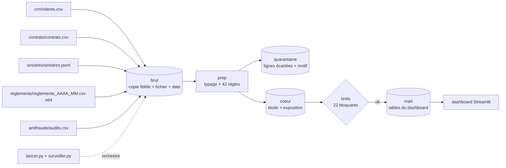

# Architecture

## Choix d'outils et critères mesurables

| Besoin | Choix | Critère mesuré |
|---|---|---|
| Entrepôt | DuckDB (un fichier) | 41 848 lignes brutes, 2,7 Mo de sources, entrepôt de 30 Mo : tient en mémoire sur un poste. Pas de serveur à installer ni à maintenir. Pipeline complet en environ 9 secondes sur la machine de développement. |
| Transformations | SQL exécuté depuis Python | Les règles de qualité sont des requêtes lisibles (`docs/regles_qualite.md`). Pas de dbt : trop d'outillage pour 5 sources et 5 jours. |
| Statistiques | pandas, numpy, scipy | Bootstrap sur 20 000 contrats × 1 000 tirages : quelques secondes. |
| Orchestration | `lancer.py` (+ Makefile) et `surveiller.py` | Une commande, arrêt au premier échec, journal des exécutions dans `mart.executions`, alerte dans `alertes.log`. |
| Dashboard | Streamlit | Python seul, lit uniquement `mart`. Pages chargées en moins d'une seconde (exigence : 5 secondes). |

## Idempotence

- Brut : un fichier déjà chargé (même nom et même empreinte MD5) est ignoré. Un fichier modifié remplace ses lignes (`DELETE` puis `INSERT` dans une transaction), il n'est jamais ajouté deux fois.
- Cœur : insertion `WHERE NOT EXISTS` sur la clé, plus clés primaires. L'exposition, dérivée de la dimension contrat, est recalculée.
- Quarantaine, prep et marts : reconstruits à chaque lancement à partir de ce qui est en dessous.
- Le même mois livré sous un autre nom ajoute ses lignes dans le brut mais elles partent en quarantaine (règle R02) : le cœur ne bouge pas. Preuve : `test_rejeu.py`.

## Planification mensuelle

`python surveiller.py --une-fois` compare la liste des fichiers de `sources/` (taille, date de modification) à l'état précédent et ne lance `lancer.py` que si quelque chose a changé. Exemple de planification Linux, toutes les heures : `0 * * * * cd /chemin/projet && python surveiller.py --une-fois`. Sous Windows : planificateur de tâches avec la même commande. En cas d'échec, `lancer.py` écrit dans `alertes.log` ; la fonction `alerter()` est l'endroit où brancher un e-mail ou un message d'équipe.

## Avec 100 fois plus de données (≈ 4 millions de lignes brutes, ≈ 3 Go)

- DuckDB reste utilisable seul sur une machine, mais plusieurs utilisateurs simultanés et les reprises sur incident justifient PostgreSQL ou un entrepôt cloud.
- Fichiers sources convertis en Parquet, partitionnés par mois ; chargement uniquement des nouveaux fichiers.
- Orchestrateur (Airflow ou Dagster) pour les reprises automatiques, les dépendances et les alertes ; dbt pour versionner les transformations et les tests.
- Mart `portefeuille_mensuel` (250 000 lignes) pré-agrégé davantage ; bootstrap sur un échantillon ou en calcul distribué.
- Ce qui ne change pas : couches, règles de qualité, quarantaine, tests, grain des faits.

## Modèle dimensionnel

- `fact_exposition` : grain **contrat × année civile**. Base de toute fréquence, prime acquise et ratio. L'année est le grain le plus fin utile aux analyses annuelles ; le mois est calculé à part dans le mart pour l'évolution mensuelle (réconcilié par un test).
- `fact_sinistre` : un sinistre. `fact_reglement` : un paiement. `fact_audit` : un sinistre audité.
- Dimensions : `dim_date`, `dim_contrat`, `dim_client`, `dim_garantie`, `dim_segment_risque`.
- **Historique** : type 1 (la valeur est écrasée). La source est un cliché à une date, sans historique des changements : il n'y a rien à historiser. Le type 2 serait nécessaire si l'on recevait des mouvements (changement de formule, de région) et exigerait une clé de substitution et des dates de validité. Limite : une résiliation reçue plus tard écrase l'ancienne valeur (`UPDATE` dans `coeur.py`).

## Déduplication des clients

- **Clé de rapprochement : l'empreinte d'e-mail.** Elle est présente pour toutes les lignes et distingue des personnes. Ajouter la date de naissance aurait fait manquer 2 doublons dont la date est vide dans les deux fiches.
- **Contrôle** : dans les 200 groupes, date de naissance, région et CSP concordent (`coeur.controle_doublons`).
- **Taux** : 200 identifiants fusionnés sur 15 200 lignes (1,32 %).
- **Règle de survie** : on garde l'identifiant qui a le contrat le plus ancien ; en cas d'égalité, le plus petit identifiant. Dans les données, le doublon n'a aucun contrat.
- **Contrats rattachés** : ils sont repointés vers l'identifiant conservé (`dim_contrat.client_id`), l'identifiant d'origine reste dans `client_id_source` et dans `coeur.correspondance_client`.
