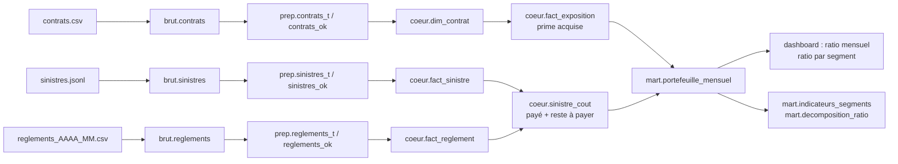

# Lignage d'un indicateur : le ratio sinistres/primes

| Étape | Table | Calcul |
|---|---|---|
| Source | `contrats.csv` | `prime_annuelle`, `date_effet`, `date_resiliation` |
| Préparation | `prep.contrats_ok` | conversions de types ; contrats à prime ≤ 0 ou à résiliation ≤ effet en quarantaine |
| Cœur | `coeur.fact_exposition` | `jours / 365,25` et `prime × jours / 365,25` par contrat et par année |
| Source | `sinistres.jsonl`, `reglements_*.csv` | réserve initiale, statut, paiements |
| Cœur | `coeur.sinistre_cout` | `paye` = somme des règlements ; `reste_a_payer` = réserve − payé pour les dossiers ouverts |
| Mart | `mart.portefeuille_mensuel` | somme par mois et segment de `prime_acquise`, `paye`, `reserve` |
| Dashboard | page Portefeuille | `(paye + reserve) / prime_acquise` |

Contrôles sur ce chemin : `exposition_totale`, `reconciliation_reglements_*` (tests) et la réconciliation mart/cœur à la fin de `marts.py`.
